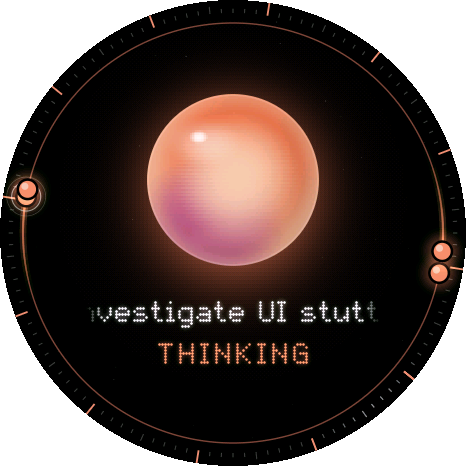
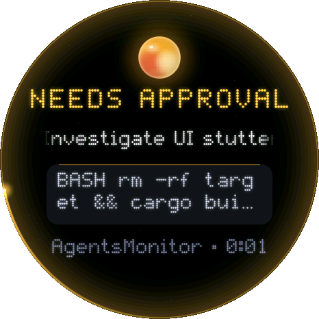
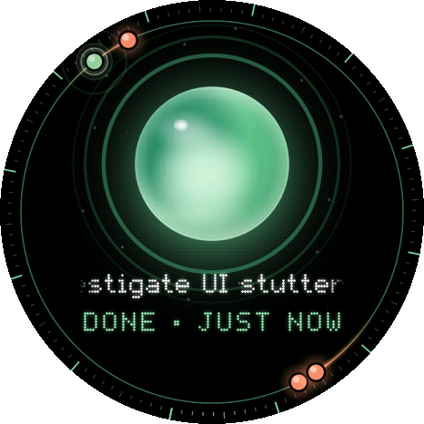
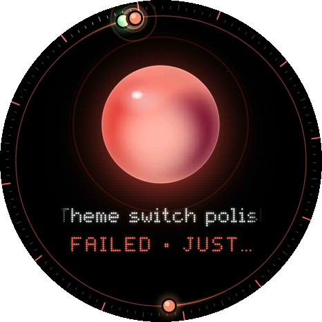
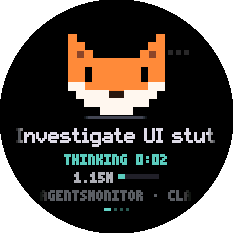
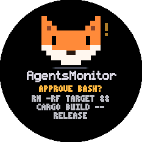
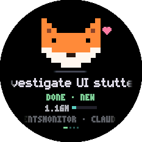
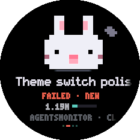
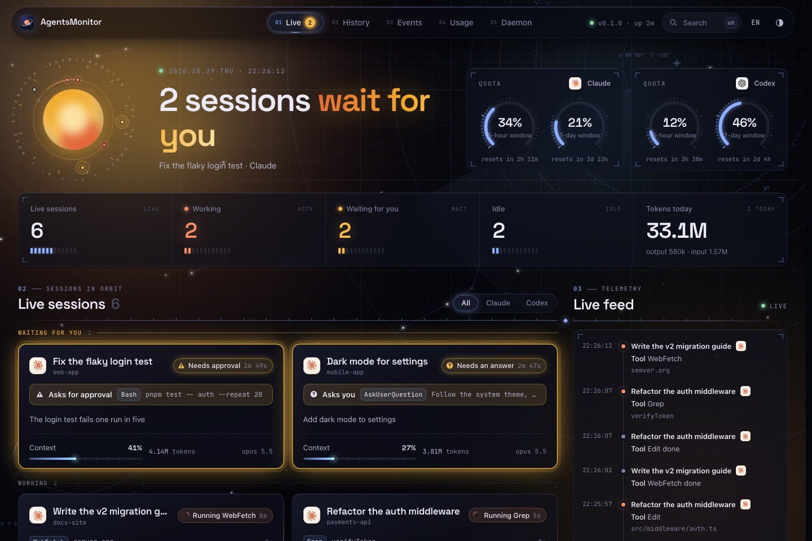

<p align="center">
  
</p>

<p align="center">
  <b>Hand your agents the work. Go watch a show.</b><br>
  A little round screen on your desk keeps an eye on every Claude Code and Codex session,<br>
  and tells you the moment one of them needs you.
</p>

<p align="center">
  <a href="LICENSE"></a>
  
  
  
</p>

<p align="center"><b>English</b> · <a href="README.zh-CN.md">简体中文</a></p>

---

## 🎬 Look up only when it matters

You give Claude Code a refactor, start Codex on a test suite, and go do something else: an episode, a scroll through X, a ranked match. One question keeps pulling you back to the terminal: *is it done yet, or has it been waiting for me all along?*

AgentsMonitor answers it from the corner of your eye. A small round display beside your monitor shows every agent at once, in a colour you can read without looking and a chime you can hear without looking at all. No alt-tabbing, no peeking at terminals, and no more coming back to find an approval that sat unanswered for twenty minutes.

## 👀 At a glance

<table>
  <tr>
    <th></th>
    <th>🟠 Working</th>
    <th>🟡 Needs you</th>
    <th>🟢 Done</th>
    <th>🔴 Failed</th>
  </tr>
  <tr>
    <td align="center"><b><code>halo</code></b></td>
    <td align="center"></td>
    <td align="center"></td>
    <td align="center"></td>
    <td align="center"></td>
  </tr>
  <tr>
    <td align="center"><b><code>pets</code></b></td>
    <td align="center"></td>
    <td align="center"></td>
    <td align="center"></td>
    <td align="center"></td>
  </tr>
  <tr>
    <td align="center"><sub>You hear</sub></td>
    <td align="center"><sub>Nothing. Keep watching.</sub></td>
    <td align="center"><sub>A chime, then gentle reminders at 2 and 5 minutes and every 10 after</sub></td>
    <td align="center"><sub>A soft chime</sub></td>
    <td align="center"><sub>A low, falling tone</sub></td>
  </tr>
  <tr>
    <td align="center"><sub>You do</sub></td>
    <td align="center"><sub>Nothing at all</sub></td>
    <td align="center"><sub>Look up: it shows the exact command or question</sub></td>
    <td align="center"><sub>Check the result when the episode ends</sub></td>
    <td align="center"><sub>Go and see what broke</sub></td>
  </tr>
</table>

<sub>Real frames from the display code, rendered with made-up sessions. Two themes, one set of news: pick the one you like, or <a href="devices/themes/README.md">make your own</a>.</sub>

## 📟 The desk display


- **One glance, every agent.** The screen takes the mood of all your sessions together: the one that needs you most always wins.
- **It says what it wants.** An approval shows the command it wants to run, and a question shows the question, before you even reach for the keyboard.
- **Swipe and tap.** Swipe through sessions, swipe up for the list, tap one for its tokens and context. The side button jumps to whoever needs you most; press it twice for everyone.
- **Pick a look.** The glowing `halo`, the pixel `pets` (rumour says there's a dragon 🐉), or a theme of your own, started from a template in five minutes.
- **Any screen will do.** The firmware targets the [Waveshare ESP32-S3-Touch-AMOLED-1.75C](https://www.waveshare.com/esp32-s3-touch-amoled-1.75c.htm) only because it is the board on the author's desk. Port it to another ESP32 and screen, or turn a Raspberry Pi, an e-ink panel or an old phone into a display: all a display needs is one small JSON document.
- **No board yet?** [Try it in your browser](devices/README.md#-try-it-in-your-browser): the same code, pixel for pixel.

<br clear="right">

## 🚀 Quick start

**You need** macOS or Linux, [Rust](https://rustup.rs) 1.95+, and Claude Code and/or Codex.

**1 · Install the daemon.** It runs quietly in the background, using about 7 MB of memory.

```bash
git clone https://github.com/1vxx/AgentsMonitor.git && cd AgentsMonitor
cargo install --locked --path crates/agentsmon
agentsmon service install    # macOS: runs it at login. On Linux, run `agentsmon serve`
```

**2 · Connect your agents.** This repository is also a plugin marketplace. Run the lines for the agents you use:

```bash
# Claude Code
claude plugin marketplace add "$PWD" && claude plugin install agentsmon@agentsmon

# Codex: afterwards, restart Codex and trust the plugin's hooks with /hooks
codex plugin marketplace add "$PWD" && codex plugin add agentsmon@agentsmon
```

`agentsmon status` now lists every session you start 🎉

**3 · Put it on your desk.** Open the daemon to your Wi-Fi, give the board your network's name and the daemon's address, and flash it. About fifteen minutes, step by step in the [devices guide](devices/README.md#-build-the-reference-display). The last step is one line:

```bash
THEME=halo devices/boards/waveshare_amoled_175c/build.sh --upload    # or THEME=pets
```

> [!TIP]
> Want to look around first? `python3 scripts/demo.py` runs everything on [made-up sessions](docs/USAGE.md#demo-mode), no agents needed. If you get `agentsmon: command not found`, `~/.cargo/bin` is not on your `PATH` yet: [here's the fix](docs/USAGE.md#agentsmon-is-not-found-after-cargo-install).

## 📊 For the numbers, a dashboard

The display is for glancing. When you want the details (how many tokens today, how close you are to your limits, what happened while you were away), open the web dashboard:

```bash
pnpm --dir web install && pnpm --dir web dev    # needs Node.js 20.19+ and pnpm; opens on http://127.0.0.1:5173
```

<p align="center"></p>

Live session cards, a timeline for each session, history, the event stream, and token charts by model, by day and by source. All of it is in the [usage guide](docs/USAGE.md#dashboard).

## ✨ Under the hood

- 🎯 **Exact token counts.** Every model request is counted once, from the agents' own logs, with your five-hour and weekly limits beside them.
- 🪶 **Never in the way.** Hooks only queue an event and return, so an agent never waits on the monitor. The display draws at around 60 fps on a small ESP32-S3 board.
- 🔒 **Local only.** Nothing leaves your machine. The display talks to your own computer over your own network, with a token.
- 🧹 **Tidy by design.** Every kind of data has a retention limit, and sessions you delete or archive in Claude Code or Codex leave the monitor too.

## 🧩 How it works

```
 Claude Code ── plugin (in-process hooks) ──┐
 Claude Code ── transcripts, usage limits ──┤
 Codex ──────── plugin (agentsmon hook) ────┤   Unix socket / 127.0.0.1:7788
 Codex ──────── rollout logs ───────────────┤
                                            ▼
                        ┌──────────────────────────────────────┐
                        │  agentsmon daemon (Rust, ~7 MB)      │
                        │  reducer → sessions, quotas, tokens  │
                        │  SQLite (WAL), bounded retention     │
                        └───────────────────┬──────────────────┘
                                            │  REST + WebSocket, over your Wi-Fi
               ┌────────────────────┬───────┴────────────┬──────────────────────┐
               ▼                    ▼                    ▼                      ▼
        📟 desk display      your own device       web dashboard         agentsmon status
```

Each agent reports what it does through a plugin, and the daemon reads the agents' own logs for exact token counts. One small daemon turns all of it into live state, and every screen reads the same summary. Another agent needs only an adapter and an integration: see [Adding an agent](docs/ARCHITECTURE.md#adding-an-agent).

## 🤔 FAQ

**Do I need the hardware?** No. The [browser preview](devices/README.md#-try-it-in-your-browser), the dashboard and `agentsmon status` all work without it. But a screen you never have to switch to is the whole point, and the reference board takes about fifteen minutes to set up.

**Will it slow my agents down?** No. Hooks queue an event and return at once; one round trip to the daemon takes about 70 µs.

**How far from my computer can the display be?** Anywhere on the same Wi-Fi. The daemon listens on your network only when you tell it to, and only with a token.

**Which agents does it support?** Claude Code (terminal and Desktop) and Codex today. Others need only an adapter: [help wanted](docs/ARCHITECTURE.md#adding-an-agent).

**Can I make it look like something else?** Yes, that's what themes are for. See the [theme guide](devices/themes/README.md).

## 📚 Documentation

| Guide | What's inside |
| --- | --- |
| 📟 [Devices](devices/README.md) | Try the display in your browser, flash the reference board, port it to your own hardware |
| 🎨 [Themes](devices/themes/README.md) | Make a new look for the display: the interface, the toolbox, the checks |
| 🧭 [Usage guide](docs/USAGE.md) | CLI, configuration, demo mode, the dashboard, token counting, retention, privacy, troubleshooting |
| 🏗️ [Architecture](docs/ARCHITECTURE.md) | How the daemon works inside, and how to add another agent |
| 🔌 [Protocol and API](docs/PROTOCOL.md) | Events, REST routes and WebSocket messages, for building your own display |
| 🧩 Plugins | [Claude Code](plugins/claude-code/README.md) · [Codex](plugins/codex/README.md) |

## 🗂️ Repository

| Path | Contents |
| --- | --- |
| `devices/` | The display: shared core, themes, boards, and the browser preview |
| `crates/agentsmon` | The daemon, hook forwarder and CLI, in one binary |
| `crates/agentsmon-protocol` | Wire types: events, sessions, quotas, summaries, WebSocket messages |
| `plugins/` | The Claude Code plugin (a hooks module) and the Codex plugin (command hooks) |
| `web/` | The web dashboard (React, Vite), started only when you want it |
| `scripts/` | `demo.py`, the daemon on made-up sessions |
| `docs/` | Guides and reference |

## 🗺️ Roadmap

- [x] Daemon, protocol, storage, REST and WebSocket API
- [x] Claude Code and Codex: status, tools, subagents, approvals and questions, compaction, context, rate limits
- [x] Exact token accounting from the agents' own logs
- [x] Desk display: the reference board, the browser preview, and themes on a shared host (halo, pets, and a starter)
- [x] Web dashboard and bounded retention
- [ ] More themes ([make one](devices/themes/README.md))
- [ ] More boards and screen sizes ([help wanted](CONTRIBUTING.md))
- [ ] More agents ([help wanted](docs/ARCHITECTURE.md#adding-an-agent))

## 🤝 Contributing

Issues and pull requests are welcome, especially new themes, boards and agent adapters. [CONTRIBUTING.md](CONTRIBUTING.md) explains how to build, test and send a change. Built a display of your own? [Show it off](https://github.com/1vxx/AgentsMonitor/issues/new?template=show_your_build.yml) 🐾

## 📄 License

[MIT](LICENSE). AgentsMonitor is an independent project, not affiliated with or endorsed by Anthropic or OpenAI. Claude, Claude Code and Codex are trademarks of their respective owners.
