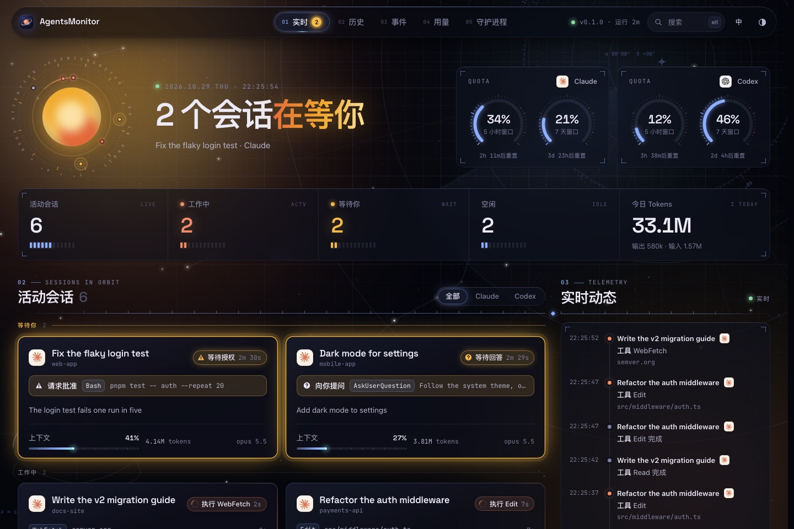
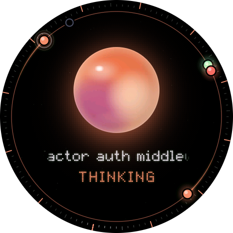
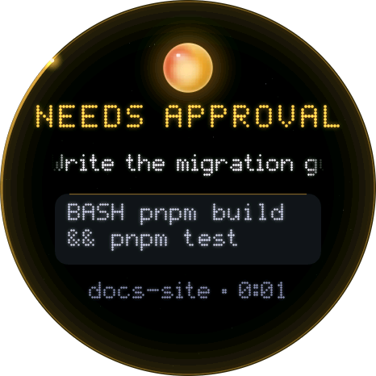
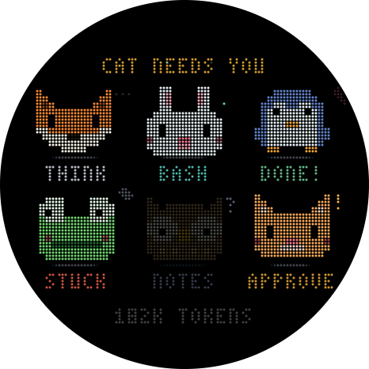
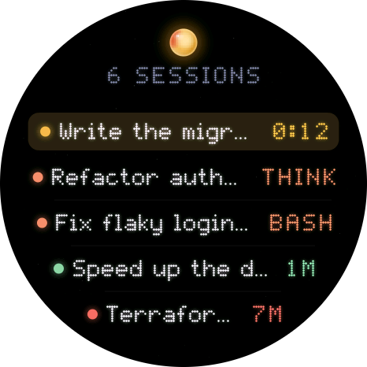
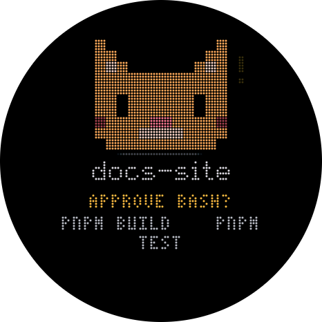

<p align="center">
  
</p>

<p align="center">
  <b>不用来回切窗口，也知道每个编码代理在干什么。</b><br>
  一个在本机运行的小守护进程，盯着你的 Claude Code 和 Codex 会话，<br>
  把它们显示在浏览器里、终端里，或者桌上的一块小屏幕上。
</p>

<p align="center">
  <a href="LICENSE"></a>
  
  
  
</p>

<p align="center"><a href="README.md">English</a> · <b>简体中文</b></p>

---

## ✨ 为什么需要它

你同时开着三个代理：一个等你授权已经十分钟了，一个早就干完了，还有一个出了错你没看到。AgentsMonitor 盯着本机上的每个会话，谁在思考、谁在跑工具、谁在等你、谁已经完成，一眼就能看清。

- 🛰️ **实时状态**：每个会话在思考、运行工具（以及是哪个工具）、等你授权或回答、压缩上下文，还是空闲。
- 🔢 **精确的 token 数**：从代理自己的日志里统计每一次模型请求，同时显示上下文占用和账户的 5 小时、每周限额。
- 🖥️ **Web 仪表盘**：实时会话卡片、每个会话的时间线、历史、事件流和用量图表。
- 📟 **桌上的小屏幕**：可选。仓库里自带一块圆形 AMOLED 开发板的固件，而且从设计上就支持[移植到你自己的硬件](devices/README.zh-CN.md#-改成你自己的)。
- 🪶 **轻量**：钩子从不让代理等待，守护进程只占约 7 MB 内存。
- 🔒 **只在本机**：数据不会离开你的电脑，每类数据都有保留期限。

## 🔭 看一眼

<p align="center"></p>

<table>
  <tr>
    <td align="center"><br><sub><b>halo</b>：情绪光球</sub></td>
    <td align="center"><br><sub>谁在等你，等什么</sub></td>
    <td align="center"><br><sub><b>pets</b>：每个会话一只小动物</sub></td>
    <td align="center"><br><sub>所有会话一览</sub></td>
  </tr>
</table>

<sub>这里的会话都是虚构的：仪表盘运行在<a href="docs/USAGE.zh-CN.md#演示模式">演示模式</a>下，圆屏画面来自真实的显示代码。不需要任何硬件，就能在浏览器里上手玩：见<a href="devices/README.zh-CN.md#-在浏览器里试试">在浏览器里试试</a>。</sub>

## 🚀 快速开始

**需要**：macOS 或 Linux、[Rust](https://rustup.rs) 1.95+，以及 Claude Code 或 Codex（或两者都有）。Web 仪表盘还需要 Node.js 20.19+ 和 [pnpm](https://pnpm.io)。

**1 · 安装守护进程**

```bash
git clone https://github.com/1vxx/AgentsMonitor.git && cd AgentsMonitor
cargo install --locked --path crates/agentsmon
agentsmon service install    # macOS：登录时自动运行。Linux 上请运行 `agentsmon serve`
```

**2 · 连接你的代理**。这个仓库同时也是一个插件市场，运行你用的代理对应的那一行：

```bash
# Claude Code
claude plugin marketplace add "$PWD" && claude plugin install agentsmon@agentsmon

# Codex：装好后重启 Codex，并用 /hooks 信任插件的钩子
codex plugin marketplace add "$PWD" && codex plugin add agentsmon@agentsmon
```

**3 · 看起来**。新开一个代理会话，一秒内就会出现 🎉

```bash
agentsmon status                                 # 在终端里看
pnpm --dir web install && pnpm --dir web dev     # 仪表盘：http://127.0.0.1:5173
```

> [!TIP]
> 如果提示 `agentsmon: command not found`，说明 `~/.cargo/bin` 还不在 `PATH` 里：[看这里解决](docs/USAGE.zh-CN.md#cargo-install-之后找不到-agentsmon)。想在连上代理之前先看看？`python3 scripts/demo.py` 会用[虚构的会话](docs/USAGE.zh-CN.md#演示模式)把一切跑起来。从源码运行、更新、卸载和配置，都在[使用指南](docs/USAGE.zh-CN.md)里。

## 📟 摆到桌上



键盘旁边的一块小屏幕：有代理等你时会亮起来，一轮完成时会响一声，滑一滑就能翻看每个会话。

- **可选**：没有它，上面的一切照常工作。
- **不绑定某一块板子**：固件目前适配的是 [微雪 ESP32-S3-Touch-AMOLED-1.75C](https://www.waveshare.com/esp32-s3-touch-amoled-1.75c.htm)，只是因为作者手上正好是这块。显示代码分成可移植的核心、可替换的主题，以及每块板子一层薄薄的驱动，换一块 ESP32、换一块屏幕，只需要写它自己的驱动。
- **什么都能当屏幕**：树莓派、墨水屏、M5Stack、一部旧手机……只要能发 HTTP 请求，就能当显示设备，它只需读取一份很小的 JSON。
- **选一个外观，或者自己做**：主题决定屏幕画什么、怎么动：发光的 `halo`、像素风的 `pets`，或者[你自己的](devices/themes/README.zh-CN.md)，从模板开始五分钟就能起步。

👉 [设备指南](devices/README.zh-CN.md)：在浏览器里试试、刷写参考开发板，或移植到你的硬件上。

<br clear="right">

## 🧩 工作原理

```
 Claude Code ── plugin (in-process hooks) ──┐
 Claude Code ── transcripts, usage limits ──┤
 Codex ──────── plugin (agentsmon hook) ────┤   Unix socket / 127.0.0.1:7788
 Codex ──────── rollout logs ───────────────┤
                                            ▼
                        ┌──────────────────────────────────────┐
                        │  agentsmon daemon (Rust, ~7 MB)      │
                        │  reducer → sessions, quotas, tokens  │
                        │  SQLite (WAL), bounded retention     │
                        └───────────────────┬──────────────────┘
                                            │  REST + WebSocket
               ┌────────────────────┬───────┴────────────┬──────────────────────┐
               ▼                    ▼                    ▼                      ▼
         Web dashboard       agentsmon status     ESP32 display        your own device
```

每个代理通过插件上报自己在做什么，守护进程再从代理自己的日志里读出精确的 token 数。一个小小的守护进程把这些整理成实时状态，提供给任何想显示它的东西。接入其他代理只需要一个适配器和一个集成：见 [Adding an agent](docs/ARCHITECTURE.md#adding-an-agent)（英文）。

## 📚 文档

| 指南 | 内容 |
| --- | --- |
| 🧭 [使用指南](docs/USAGE.zh-CN.md) | 命令行、配置、token 统计、会话状态、数据保留、隐私、故障排查 |
| 📟 [设备](devices/README.zh-CN.md) | 预览页、刷写参考开发板、移植到你自己的硬件 |
| 🎨 [主题](devices/themes/README.zh-CN.md) | 为显示设备做一个新外观：接口、工具箱和检查方法 |
| 🏗️ [架构](docs/ARCHITECTURE.md)（英文） | 守护进程内部如何工作，以及如何接入其他代理 |
| 🔌 [协议与 API](docs/PROTOCOL.md)（英文） | 事件、REST 接口和 WebSocket 消息，用来写你自己的客户端 |
| 🧩 插件（英文） | [Claude Code](plugins/claude-code/README.md) · [Codex](plugins/codex/README.md) |

## 🗂️ 仓库结构

| 路径 | 内容 |
| --- | --- |
| `crates/agentsmon` | 守护进程、钩子转发器和命令行工具，同一个可执行文件 |
| `crates/agentsmon-protocol` | 传输用的数据类型：事件、会话、配额、汇总、WebSocket 消息 |
| `plugins/` | Claude Code 插件（钩子模块）和 Codex 插件（命令钩子） |
| `web/` | Web 仪表盘（React、Vite），只在需要时启动 |
| `devices/` | 显示设备固件：共享核心、主题、开发板，以及浏览器预览页 |
| `scripts/` | `demo.py`：让守护进程跑在虚构的会话上 |
| `docs/` | 指南和参考文档 |

## 🗺️ 路线图

- [x] 守护进程、协议、存储、REST 和 WebSocket API
- [x] Claude Code 插件：状态、工具、子代理、授权和提问、上下文压缩、上下文占用、用量限制
- [x] 根据代理自己的日志精确统计 token，可选配合 Claude Code 的逐请求遥测
- [x] Web 仪表盘
- [x] 有上限的数据保留，跟随 Claude Code 和 Codex 中的删除和归档
- [x] Codex 适配器和插件
- [x] 桌面显示设备：参考开发板、浏览器预览页，以及基于共享 host 的主题（halo、pets 和起步模板）
- [ ] 更多主题（[做一个](devices/themes/README.zh-CN.md)）
- [ ] 更多开发板和屏幕尺寸（[欢迎参与](CONTRIBUTING.md)）
- [ ] 更多代理（[欢迎参与](docs/ARCHITECTURE.md#adding-an-agent)）

## 🤝 参与贡献

欢迎提交 Issue 和 Pull Request，尤其是新的主题、开发板和代理适配器。[CONTRIBUTING.md](CONTRIBUTING.md) 说明了如何构建、测试和提交改动。做了自己的显示设备？[来晒一晒](https://github.com/1vxx/AgentsMonitor/issues/new?template=show_your_build.yml) 🐾

## 📄 许可证

[MIT](LICENSE)。AgentsMonitor 是独立项目，与 Anthropic 和 OpenAI 没有关联，也未获得其背书。Claude、Claude Code 和 Codex 是其各自所有者的商标。
