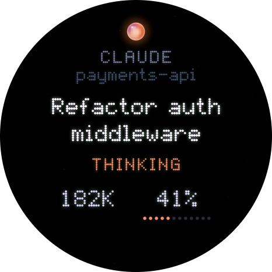

# 📟 Devices

A small screen for your desk that shows what your coding agents are doing. It lights up when one needs you, chimes when a turn finishes, and lets you swipe through every session.

English | [简体中文](README.zh-CN.md)

<p align="center">
  
  
  
  
</p>

> [!NOTE]
> **The board here is one example, not a requirement.** The firmware targets the Waveshare ESP32-S3-Touch-AMOLED-1.75C only because that is the board on the author's desk. Everything a display needs comes from one small JSON document the daemon serves, and the display code keeps the hardware in a thin layer of its own. Use another ESP32, another screen, or something that isn't a microcontroller at all: [Make it yours](#-make-it-yours) shows how.

**Contents:** [Pick your path](#-pick-your-path) · [Try it in your browser](#-try-it-in-your-browser) · [Themes](#-themes) · [Build the reference display](#-build-the-reference-display) · [Make it yours](#-make-it-yours)

## 🧭 Pick your path

| You have | Do this | Effort |
| --- | --- | --- |
| No hardware yet | [Try it in your browser](#-try-it-in-your-browser) | ☕ a few minutes |
| The Waveshare 1.75C | [Build the reference display](#-build-the-reference-display) | 🔧 about 15 minutes |
| Another ESP32 and a screen | [Port it to your board](#path-a-another-esp32-board) | 🛠️ an afternoon |
| A Raspberry Pi, e-ink panel, M5Stack, old phone… | [Read the API](#path-c-anything-that-speaks-http) | 🐍 about 20 lines of code |
| An idea for a new look | [Make a theme](themes/README.md) | 🎨 start in five minutes |

## 🎮 Try it in your browser

The review page runs the same C++ display code as the firmware, compiled to WebAssembly and drawn pixel for pixel on a 466 × 466 canvas. It plays scripted demo days or shows your own live sessions, switches between every theme, and speaks English and Chinese.

You need [Emscripten](https://emscripten.org) (`brew install emscripten`) and Python 3. From the repository root:

```bash
devices/sim/build.sh                       # builds every theme
python3 -m http.server 8466 --bind 127.0.0.1 --directory devices
```

Open http://127.0.0.1:8466 and pick a theme at the top. Drag on the round screen to swipe, click to tap, and press `B` for the side button; `?` lists every shortcut. The page follows your system's light or dark mode, or pick one at the top. To see your own sessions, switch the data source to the live daemon (`ws://127.0.0.1:7788/v1/ws`, plus the token if you set one). No agents at hand? [`scripts/demo.py`](../docs/USAGE.md#demo-mode) runs a daemon full of made-up sessions to point it at.

> In Claude Desktop, the `device` entry in `.claude/launch.json` serves this page.

## 🎨 Themes

A **theme** decides what is drawn and how it moves. Each firmware image holds one: pick it with `THEME=` when you build. The review page has them all.

| | Theme | What it is |
| --- | --- | --- |
|  | **`halo`** (default) | A glowing orb whose colour is the overall mood, with each session as a satellite on the ring around it. A session that starts waiting for you takes over the screen with what it wants to run. Swipe up for the list, then tap a row for its tokens and context. |
|  | **`pets`** | Each session is a pixel animal on an LED dot board, acting out its state: it nods while thinking, jitters and throws sparks while running a tool, hops with a `!` when it needs you, and naps when idle. Swipe up to see the whole crew. Rumour has it there is a dragon 🐉 |

Want a look of your own? The [theme guide](themes/README.md) takes you from a copied template to your own theme on the board, with the interface, the toolbox and the checks.

**Controls** on the reference board, and the same on the review page:

| Input | Does |
| --- | --- |
| Swipe left / right | The previous or next session |
| Swipe up / down | Open the list of every session, or go back |
| Tap | Open a session, or dismiss a reminder |
| Side button (top), once | Jump to the session that needs you most |
| Side button, twice | Every session at once |
| Bottom button, hold 3 s | Summon whatever the theme keeps for rare moments |

**Sounds.** A chime when a session starts waiting for you, a soft one when a turn finishes, a low one when a turn fails. If nobody answers a wait, the display reminds you again at 2 and 5 minutes, then every 10 minutes, until you tap it.

## 🔧 Build the reference display

**Hardware:** a [Waveshare ESP32-S3-Touch-AMOLED-1.75C](https://www.waveshare.com/esp32-s3-touch-amoled-1.75c.htm) and a USB-C cable. Make sure it is the **1.75C**: the plain 1.75 is wired differently.

| Part | On the 1.75C | Driver |
| --- | --- | --- |
| SoC | ESP32-S3R8, 8 MB PSRAM, 32 MB flash | |
| Screen | 1.75" round AMOLED, 466 × 466, CO5300 over QSPI | `panel.cpp` |
| Touch | CST9217 | `touch.cpp` |
| Buttons | PWR via the AXP2101 power chip, BOOT on GPIO0 | `button.cpp` |
| Speaker | ES8311 codec over I2S | `audio.cpp` |
| Network | Wi-Fi, 2.4 GHz | `net.cpp` |

### 1. Let the display reach the daemon

By default the daemon listens only on `127.0.0.1`. Open it to your network and protect it with a token, in `~/.agentsmon/config.toml`:

```toml
[http]
listen = "0.0.0.0:7788"
token = "paste-a-long-random-string-here"    # for example from: openssl rand -hex 16
```

Restart the daemon (`agentsmon service install` restarts the login service), then note your computer's LAN address: `ipconfig getifaddr en0` on macOS, `hostname -I` on Linux. If your firewall asks, allow `agentsmon` to accept incoming connections.

### 2. Install the toolchain

```bash
brew install arduino-cli      # or see https://arduino.github.io/arduino-cli/
arduino-cli config add board_manager.additional_urls https://espressif.github.io/arduino-esp32/package_esp32_index.json
arduino-cli core update-index && arduino-cli core install esp32:esp32
arduino-cli lib install SensorLib
```

Tested with arduino-cli 1.5, the esp32 core 3.3.12 and SensorLib 0.5.1.

### 3. Tell the firmware where to connect

```bash
cd devices/boards/waveshare_amoled_175c
cp secrets.example.h secrets.h
```

Fill in `secrets.h`: your Wi-Fi name and password (a 2.4 GHz network), the address from step 1 as `DAEMON_HOST`, and the token. git ignores this file.

### 4. Build and flash

Plug the board in, find its port with `arduino-cli board list`, then:

```bash
PORT=/dev/cu.usbmodem1101 ./build.sh --upload             # halo
THEME=pets PORT=/dev/cu.usbmodem1101 ./build.sh --upload  # or any other theme
```

Without `--upload` it only compiles. The board plays a soft chime when it starts, joins Wi-Fi and shows your sessions within a few seconds. 🎉

### Troubleshooting

| Symptom | What to check |
| --- | --- |
| Stuck on "connecting" | The Wi-Fi must be 2.4 GHz, and `DAEMON_HOST` must be your computer's LAN address, not `127.0.0.1` |
| Connected, then lost | Your computer may be asleep, or its address changed. Give it a fixed address on your router |
| Nothing appears at all | Test from another machine: `curl -H "Authorization: Bearer <token>" http://<host>:7788/v1/summary` should print JSON |
| `401` in the serial log | The token in `secrets.h` doesn't match `http.token` |
| Want to see the logs | `arduino-cli monitor -p <port> -c baudrate=115200` prints the link state, frame rate and free memory every second |
| The upload can't find the board | Hold BOOT while plugging in the cable, then upload again |

## 🧰 Make it yours

### How the code is layered

```
devices/
├── themes/    🎨 what to draw and how it moves: halo, pets, and the _template
│                 new themes start from; each implements core/theme.h
├── core/      🧮 portable C++17, no platform underneath:
│                 host.cpp   the display as boards see it (ui.h), run by the theme
│                 the summary model, waits and finished turns, drawing, text,
│                 chimes, springs and gestures, shared by every theme
├── boards/    🔌 one folder per board: drivers + an Arduino sketch, talking to ui.h
│   └── waveshare_amoled_175c/       ← the only hardware-specific code
├── sim/       🎮 the review page (the same code in WebAssembly) and snap.mjs
├── fonts/     🔤 the bitmap font for Chinese titles (Latin text is built in)
└── tools/     🧪 new_theme.sh, and build helpers shared by boards
```

Themes and boards mix freely: any theme runs on any board whose screen it fits. You only ever touch the layer you are changing.

### Path A: another ESP32 board

Copy `boards/waveshare_amoled_175c/` to `boards/<your_board>/`, rename the `.ino` to match the folder, and replace the drivers. The sketch only has to do this:

| Job | How | Needed? |
| --- | --- | --- |
| Start the UI | `ui::init(CJK10, sizeof CJK10)` with the font `build.sh` embeds | ✅ |
| Fetch the summary | `GET /v1/summary` about once a second with `Authorization: Bearer <token>`, and hand the body to `ui::summary(json)`. Report the link with `ui::link(CONNECTING / ONLINE / LOST)` | ✅ |
| Draw | Each frame, call `ui::frame(ms)`, then `ui::draw(band, y0, y1)` for bands of rows, and send each band to your panel: big-endian RGB565, 466 pixels a row. Bands mean no full frame buffer is needed | ✅ |
| Touch | `ui::touch(DOWN / MOVE / UP, x, y, ms)` | optional |
| Buttons | `ui::press(ms)` for the side button, `ui::summon(ms)` for a long hold | optional |
| Sound | Play each `ui::cue()` with `core/synth` through your speaker | optional |
| Seen | Send each `ui::seen(key, len, &endedAt)` to the daemon as `POST /v1/sessions/<key>/seen` with `{"ended_at": endedAt}`, so a turn tapped here stops being new everywhere | optional |

`net.cpp` (polling over Wi-Fi) and the frame loop in the `.ino` usually carry over unchanged. **What the core needs:** an ESP32-S3-class chip with PSRAM, where the core keeps over 1 MB of buffers. A second core is optional: drawing splits across both when there are two (`gfx::split`), and runs one half after the other when there is one.

`build.sh` copies `core/` and the chosen theme into the sketch's `src/ui/` and compiles. Change the `FQBN` line for your board. A board that isn't Arduino keeps the same shape: its own build script, with the core and the theme compiled alongside.

### Path B: another screen size or shape

Today the core draws a 466 × 466 frame (`gfx::W` and `gfx::H` in `core/gfx.h`), and the themes are laid out for a round panel of that size:

- **A 466 × 466 square panel** works as it is. The corners stay black.
- **A larger panel**: center the frame by offsetting the window in your panel driver.
- **A smaller or non-square panel**: the frame size has to become a parameter first, and the layouts need to follow. This is the most wanted contribution right now, so [open an issue](https://github.com/1vxx/AgentsMonitor/issues/new/choose) and let's design it together.

### Path C: anything that speaks HTTP

No C++ needed. The daemon serves everything a display shows as one small JSON document:

```bash
curl -H "Authorization: Bearer <token>" http://<host>:7788/v1/summary
```

```jsonc
{
  "ts": 1793087903676,
  "mood": "attention",           // attention > working > error > idle > offline: one colour for the whole screen
  "counts": { "live": 3, "waiting": 1, "thinking": 1, "tool": 0, "idle": 1, "compacting": 0, "stale": 0 },
  "sessions": [                  // most urgent first, at most eight
    {
      "key": "claude-code:4f0c…", "agent": "claude-code",
      "project": "docs-site", "title": "Write the migration guide",
      "status": "waiting_permission", "since": 1793087900000,
      "attention": { "kind": "permission", "tool": "Bash", "subject": "pnpm build && pnpm test" },
      "tokens": 182000, "context": { "percent": 41 }
    }
  ],
  "quotas": [ { "agent": "claude-code", "windows": [["five_hour", 21.0], ["seven_day", 13.0]] } ]
}
```

A whole "display" in Python, for a terminal, a Raspberry Pi or anything else:

```python
import json, time, urllib.request

DAEMON = "http://192.168.1.18:7788"   # the machine running agentsmon
TOKEN = "the-token-from-config.toml"

ICONS = {"waiting_permission": "✋", "waiting_input": "❓", "tool": "🔧",
         "thinking": "💭", "compacting": "🗜 ", "idle": "💤"}

while True:
    req = urllib.request.Request(f"{DAEMON}/v1/summary",
                                 headers={"Authorization": f"Bearer {TOKEN}"})
    summary = json.load(urllib.request.urlopen(req, timeout=3))
    print(f"\033[2J\033[H mood: {summary['mood']}")
    for s in summary["sessions"]:
        icon = "📡" if s.get("stale") else ICONS.get(s["status"], "·")
        print(f" {icon} {s['project']:<16} {s.get('title', '')[:40]:<40} {s.get('tool', '')}")
    time.sleep(1)
```

Polling once a second is plenty. For instant updates, open the WebSocket at `/v1/ws` (with `?token=`) and watch for `summary` messages. Every field is described in [Protocol and API](../docs/PROTOCOL.md).

### Make a theme

A new look needs no new hardware, and no knowledge of any board: see the [theme guide](themes/README.md).

### Show it off

Built a display of your own, or ported it to a new board? [Share it](https://github.com/1vxx/AgentsMonitor/issues/new?template=show_your_build.yml), and pull requests for new boards and themes are very welcome. See [CONTRIBUTING.md](../CONTRIBUTING.md). 🐾
