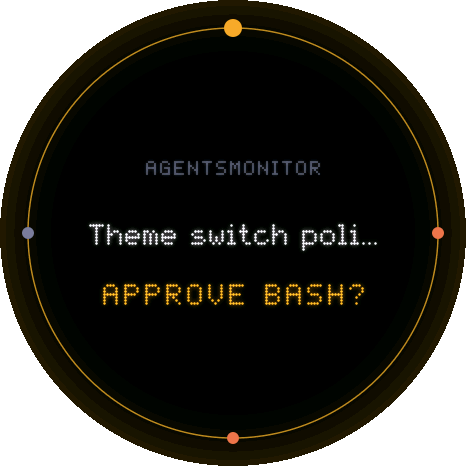

# 🎨 Themes

A theme is the look and feel of the display: what it draws and how it moves. Every theme runs on every board and in the browser, from one folder here. Each firmware image holds one theme, which you pick when you build it.

English | [简体中文](README.zh-CN.md)

<table>
  <tr>
    <td align="center"><br><b><code>halo</code></b><br><sub>A glowing orb in the mood of all your sessions</sub></td>
    <td align="center"><br><b><code>pets</code></b><br><sub>A pixel animal per session, acting out its state</sub></td>
    <td align="center"><br><b><code>_template</code></b><br><sub>The starter every new theme is copied from</sub></td>
  </tr>
</table>

## ⚡ A new theme in five minutes

```bash
devices/tools/new_theme.sh aurora          # copies _template to themes/aurora
THEME=aurora devices/sim/build.sh          # builds it for the review page
python3 -m http.server 8466 --bind 127.0.0.1 --directory devices
```

Open http://127.0.0.1:8466/sim/?theme=aurora and edit `devices/themes/aurora/ui.cpp`. Rebuild and reload to see each change. When you like it, flash it:

```bash
THEME=aurora devices/boards/waveshare_amoled_175c/build.sh --upload
```

## 🧩 How a theme fits

```
   board                       host                          theme
 ┌─────────────────┐  ui.h  ┌──────────────────────┐ theme.h ┌──────────────────┐
 │ panel, touch,   │ ─────▶ │ reads the summaries  │ ──────▶ │ what it draws,   │
 │ buttons, Wi-Fi, │        │ keeps the clocks     │         │ how it moves     │
 │ speaker         │ ◀───── │ finds what happened  │ ◀────── │                  │
 └─────────────────┘ frames │ plays shared chimes  │         └──────────────────┘
   devices/boards/  chimes  │ one press from two   │           devices/themes/
                            └──────────────────────┘
                              devices/core/host.cpp
```

Boards never see a theme, and themes never see a board. The host in the middle does everything every theme would otherwise do the same way, so all themes behave alike: the same reminders at the same times, the same chimes for the same things, the same double press.

| The host does | The theme does |
| --- | --- |
| Parses each summary into `model::Summary`, and keeps the previous one | Draws the sessions, in its own style |
| Keeps a steady clock and the wall clock (`now`, `wall`, `dt`) | Moves things, usually on `Spring`s |
| Works out the events: a session starts waiting, a turn ends, a wait goes unanswered | Reacts to them on screen |
| Plays the shared chimes for those events | Adds chimes of its own, if it has any |
| Tells one press of the side button from two, and ignores presses while a finger is down | Decides where each press goes |
| Forgets the summary and the waits when the link drops | Clears its screen in `reset()` |

## 📐 The interface

Everything is in [`core/theme.h`](../core/theme.h). A theme defines `theme::instance()` and a class that implements `theme::Theme`:

| Method | When the host calls it | Needed? |
| --- | --- | --- |
| `init()` | Once, after the core is up | ✅ |
| `frame()` | Once a frame, after the input, to advance and lay out the frame | ✅ |
| `draw(band, y0, y1)` | For each band of rows of the frame, possibly on two cores at once | ✅ |
| `event(e, next)` | For each thing that happened in a new summary, before it is current | optional |
| `summary()` | After a new summary is current, to match the theme's own objects to it | optional |
| `touch(kind, x, y, ms)` | For each finger down, move and up | optional |
| `press(times, ms)` | Side button: `times` is 1, then 2 if pressed again within 450 ms | optional |
| `summon(ms)` | The other button, held down | optional |
| `reset()` | The link to the daemon was lost | optional |
| `screen()`, `timings()` | For the logs and the review page | optional |

And what the host offers a theme:

| Call | Gives |
| --- | --- |
| `theme::state()` | The link, the latest summary, `now`, `wall`, `dt`, and the sessions waiting for you |
| `theme::chime(cue)` | Plays a chime of the theme's own |
| `theme::ack()` | Says the person has seen what waits, so the reminders stop |
| `theme::seen(key, endedAt)` | Says the person looked at a session's finished turn here; the board tells the daemon, so it stops being new everywhere |
| `theme::reminders(out, max)` | The reminders due this frame, taken at the point in `frame()` where the theme reacts to them |

## 🧰 The toolbox in `core/`

| Header | For |
| --- | --- |
| `model.h` | The summary: sessions, their status, what they wait for, how their last turn ended, tokens, context |
| `events.h` | Waits, finished turns and reminders, read off two summaries |
| `gfx.h` | Drawing on the round 466 × 466 panel: rings, arcs, discs, glows, rounded rectangles, vignettes. A frame is recorded once and played back per band |
| `text.h` | Dot-matrix text: three Latin faces and a Chinese bitmap font, with fitting, wrapping and rolling digits |
| `spring.h` | The damped spring all motion uses |
| `gesture.h` | One finger: taps, drags and their speed, with the thresholds every theme shares |
| `synth.h` | The chimes |

`halo` shows smooth vector drawing with `gfx`. `pets` shows its own pixel grid (`board.cpp`) and pixel art (`sprites.h`). The starter shows the smallest complete theme.

## ✅ What makes a good theme

- **One folder.** `themes/<name>/` holds `ui.cpp`, any files of its own, and a `theme.json` with its name and a one-line description in English and Chinese. The folder name is lowercase, and is also the C++ namespace.
- **No platform code.** No Arduino or ESP-IDF headers: the same files build for the browser and every board.
- **Every state shows.** Waiting for approval or an answer, thinking, running a tool, compacting, finished, failed, idle, no signal, no sessions, connecting and link lost. The review page's demo scripts walk through all of them.
- **Bands draw alike.** `draw()` reads only what `frame()` left, so drawing a frame in 16-row bands on two cores gives the same pixels as drawing it whole. `snap.mjs check` proves it.
- **Fast enough.** Aim for 30 fps or better on the reference board; halo and pets run near 60. The board's serial log prints the frame rate and time every second. Big tables belong in PSRAM (`gfx::bigAlloc`): internal RAM is kept for Wi-Fi.
- **Kind to an AMOLED.** Mostly black, and nothing bright in one place for hours. Both themes shift a few pixels every few minutes.
- **One screen shape for now.** Themes draw a 466 × 466 round frame (`gfx::W`, `gfx::H`). See [other screen sizes](../README.md#path-b-another-screen-size-or-shape).

## 🧪 Test it

`snap.mjs` plays the review page's scripts through a theme in Node, no browser needed. Build the theme first (`THEME=<name> devices/sim/build.sh`).

```bash
node devices/sim/snap.mjs check aurora                    # bands draw exactly like whole frames, in every script
node devices/sim/snap.mjs png aurora day 25 aurora.png    # a picture of one moment, for your pull request
```

Refactoring a theme? Prove nothing on screen changed, frame by frame:

```bash
node devices/sim/snap.mjs record aurora before.json       # before the change
node devices/sim/snap.mjs record aurora after.json        # after it, rebuilt
node devices/sim/snap.mjs compare before.json after.json  # every frame, chime and screen the same?
```

## 🐾 Share it

Open a pull request with the folder, a `snap.mjs png` picture or two, and what it shows (see [CONTRIBUTING](../../CONTRIBUTING.md#adding-a-theme)). Built it for your own desk only? [Show it off](https://github.com/1vxx/AgentsMonitor/issues/new?template=show_your_build.yml) anyway: we love to see them.
