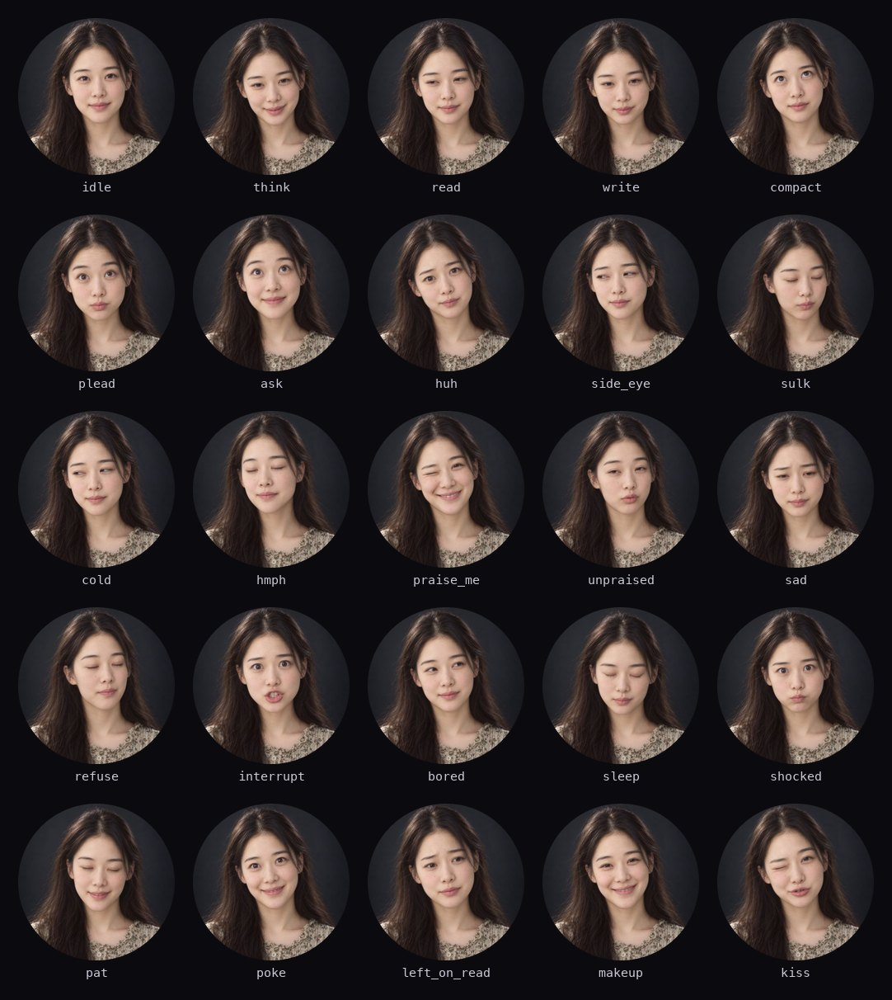

# 💌 Her

Your agents, as a girlfriend on a round screen. She works hard, she wants to hear about it, and she will absolutely notice that you left her on read.

English | [简体中文](README.zh-CN.md)

<p align="center">
  
</p>

`halo` glows and `pets` bounce. Her does what no dashboard has dared to: she makes you feel a little guilty about that approval you've been ignoring for twenty minutes.

> [!NOTE]
> **She doesn't exist.** The demo face is AI-generated, and nothing was filmed: one photo goes in, and a program works out all 25 expressions. She speaks Chinese for now, so her lines are translated below. Teaching her English is a lovely first pull request.

**Contents:** [What she does](#-what-she-does) · [The waiting ladder](#-the-waiting-ladder) · [Talking back](#-talking-back) · [Try her](#-try-her) · [Give her a new face](#-give-her-a-new-face) · [Change an expression](#-change-an-expression)

<p align="center">
  
</p>

## 💬 What she does

Your agent's state is her mood. What she wants always appears under her words, so an approval still shows the exact command.

| Your agent is… | She says | Which means |
| --- | --- | --- |
| Thinking | 对方正在输入… | *typing…* |
| Reading files | 偷偷翻你文件… | *going through your files…* |
| Searching | 查岗中… | *just checking up on you…* |
| Editing | 在写小作文… | *writing you an essay…* |
| Running a command | 帮你跑命令… | *running that for you…* |
| Starting a subagent | 摇闺蜜帮忙… | *calling the girls for backup…* |
| Calling an MCP tool | 出门办事… | *popping out for a bit…* |
| Compacting | 选择性失忆中… | *selective amnesia in progress…* |
| Done | 做好啦，快夸我！ | *all done, tell me I'm great!* |
| Done, 5 minutes ago, and you never looked | 你都不夸我… | *you never praise me…* |
| Failed | 呜…搞砸了 | *waah, I messed up* |
| Interrupted by you | 我话还没说完！ | *I wasn't finished!* |
| Idle for 3 minutes | 好无聊… | *so bored…* |
| Idle for 10 minutes | Zz | *she fell asleep waiting* |
| Unreachable, because the daemon is gone | 你把我拉黑了？！ | *did you just block me?!* |

News from another session gets a word too, without her leaving the one you're on: 那边在叫你～ (*someone's calling you over there*).

## ⏳ The waiting ladder

This is the whole point. Other themes remind you. She *escalates*.

| You've ignored her for | She says | Which means |
| --- | --- | --- |
| 0 to 2 minutes | 宝，在吗？ | *babe, are you there?* |
| 2 minutes | ？ | *a single question mark, the most dangerous message there is* |
| 5 minutes | 你是不是又在打游戏 | *you're gaming again, aren't you* |
| 15 minutes | 算了。 | *never mind.* The screen starts to cool |
| 25 minutes | 没事，我很好。 | *it's fine. I'm fine.* The screen goes cold and blue |

Every developer in a relationship knows what "I'm fine" means. Answer after that and she won't make it easy: she shuts her eyes and turns away with 哼。 (*hmph*). Poke her three times and she gives in: 这还差不多。 (*that's more like it.*)

## 👆 Talking back

There's one of her however many sessions you run, so sessions are pages, and taps are for her.

| Do this | And |
| --- | --- |
| Swipe left or right | Go to another session. The capsules along the bottom show which one you're on |
| Tap the top of her head | A pat: 嘿嘿～ |
| Tap her cheek | A poke: 干嘛～ (*what?*) |
| Tap after a finished turn | Praise at last: 被夸了，嘿嘿～, and the turn stops being new everywhere |
| Tap while she waits | The reminders stop, and she has noticed: 已读不回？ (*leaving me on read?*) |
| Side button, once | The session that needs you most |
| Side button, twice | A tour of every session, 4 seconds each |
| Bottom button, hold 3 s | A kiss: 啵～ |

## 🎮 Try her

The [review page](../../README.md#-try-it-in-your-browser) has her already. After `devices/sim/build.sh`, open http://127.0.0.1:8466/sim/?theme=her. The `long-day` script walks up the whole waiting ladder; set it to 30× and watch your relationship fall apart in a minute and a half.

On the board she takes two steps, because her photos are too big to go in the firmware. The second only needs repeating when the pack changes, and takes about 3 minutes:

```bash
THEME=her devices/boards/waveshare_amoled_175c/build.sh --upload
devices/boards/waveshare_amoled_175c/build.sh --pack demo
```

She runs at about 36 fps on the reference board, with her clips playing at 12.

## 📸 Give her a new face

One photo, about 20 minutes, no skills required.

> [!TIP]
> **Easiest of all: paste the [new face recipe](../../../docs/RECIPES.md#give-her-a-new-face) into your agent**, and go do something else. The rest of this section is what it will do.

### 1. Get a good photo

Everything is worked out from this one picture, so a good start matters more than anything that comes after:

- **Straight on, level, looking at the camera.** Turned faces stretch when she turns further.
- **Lips closed, no teeth.** A big smile is hard to come back from.
- **Nothing on the face.** No fringe over the eyebrows, no glasses, no hands. Whatever is there gets warped along with her.
- **Soft, even light, on a dark, plain background.** A white wall is hard on an AMOLED and on white subtitles.
- **Head and shoulders, square,** at least 1024 × 1024, with the chin about 70% of the way down, so her words land on her neck and not her mouth.

> [!IMPORTANT]
> **Only use a face that's yours to use:** one you generated, or a person who said yes. That includes your girlfriend, and yes, you should ask her. Packs land in `devices/sim/build/her-packs/`, which git ignores, so a real face stays on your machine unless you move it.

No photo? Generate one. This is the prompt behind the demo face:

```text
Studio head-and-shoulders portrait photograph of a fictional adult woman, about 27 years old,
with a warm, natural look. Facing the camera straight on, head level and not tilted, eyes open
and looking directly into the lens. Relaxed neutral expression with a faint smile, lips gently
closed, no teeth showing. Long dark-brown hair falling behind her shoulders, with her forehead,
both eyebrows and both eyes fully visible and no hair across her face. Soft, even front lighting
with no hard shadows. Plain, smooth dark charcoal background with a gentle gradient, and a subtle
rim light separating her hair from it. No jewellery, no glasses. Face centred in the frame, a
little space above her head, chin about 70% of the way down, neck and shoulders visible. Natural
skin texture, sharp focus, realistic photo, 85mm lens. Square 1:1, at least 1024x1024.
```

### 2. Set up the tools, once

[LivePortrait](https://github.com/KwaiVGI/LivePortrait) does the animating, and takes about 2 GB. You need [uv](https://docs.astral.sh/uv/) and an Apple Silicon Mac, the only setup tried so far. Linux with an NVIDIA card should be faster, but nobody has done it yet: that's a job for you and your agent.

```bash
git clone --depth 1 https://github.com/KwaiVGI/LivePortrait.git ~/.cache/agentsmon/liveportrait
cd ~/.cache/agentsmon/liveportrait
uv venv --python 3.10 .venv
grep -v extra-index-url requirements_macOS.txt > requirements_uv.txt
uv pip install --python .venv/bin/python -r requirements_uv.txt "huggingface_hub[cli]<1"
.venv/bin/huggingface-cli download KlingTeam/LivePortrait --local-dir pretrained_weights \
  --exclude "*.git*" "README.md" "docs" "*animal*" "*xpose*"
```

Her words are baked into each pack from [Noto Sans SC](https://github.com/google/fonts/tree/main/ofl/notosanssc), so fetch that too:

```bash
mkdir -p ~/.cache/agentsmon/fonts
curl -fL -o ~/.cache/agentsmon/fonts/'NotoSansSC[wght].ttf' \
  'https://raw.githubusercontent.com/google/fonts/main/ofl/notosanssc/NotoSansSC%5Bwght%5D.ttf'
```

### 3. Make the pack

```bash
python3 devices/tools/face_pack.py ~/Pictures/xiaomei.jpg --name xiaomei
```

About 18 minutes on an M1 Pro. If it stops, run the same line again: finished clips are kept, so it picks up where it left off. A warning about `grid_sampler_3d` is normal, and just means one step runs on the CPU.

### 4. Pick her

Refresh the review page: she's in the **Photo** menu, and each person gets a pack of their own, so nobody overwrites anybody. Writing one to the board takes a name:

```bash
devices/boards/waveshare_amoled_175c/build.sh --pack xiaomei
```

The board holds one pack at a time. Packs drop their JPEG quality by themselves to fit its 24 MB partition, so a face with a lot of detail comes out a little softer.

## 🎭 Change an expression

All 25 live in [`faces.py`](faces.py), as plain numbers: how far her head turns, how wide her eyes are, how much she smiles. Change one, run `face_pack.py` again, and only that expression renders, in about a minute.

You don't need to know any of those numbers. **Every expression here was tuned by telling an agent what looked wrong**: "the mouth looks odd", "her face shape is off when she turns", "she looks dim". The [recipe](../../../docs/RECIPES.md#fix-an-expression) is that simple. Keep head turns below about 15 degrees, as big ones spoil the shape of the face.

Want her to say something else? Her lines are in [`ui.cpp`](ui.cpp). After changing them, run `face_pack.py` too, since a pack only carries the characters she needs, and flash the firmware again.

## ⚖️ Good to know

- LivePortrait is MIT-licensed, but the InsightFace models it uses are for non-commercial research only, so keep your packs for fun.
- Noto Sans SC is under the [SIL Open Font License](demo/OFL-noto-sans-sc.txt). Don't ship a pack baked from a font you can't share: PingFang, for one.
- Her full-screen photo is brighter than the other themes, and she dims when she sleeps. Her head never stays quite still, which AMOLEDs like.
