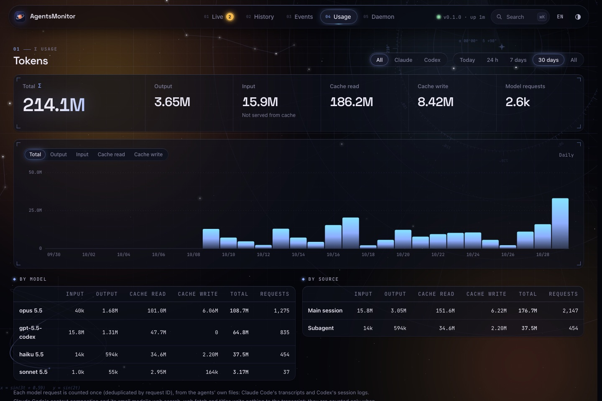

# 🧭 Usage guide

Everything past the [quick start](../README.md#-quick-start): day-to-day commands, configuration, how the numbers are counted, and what to do when something looks off.

English | [简体中文](USAGE.zh-CN.md)

**Contents**

- [Installing in detail](#installing-in-detail) · [Running from source](#running-from-source) · [Demo mode](#demo-mode) · [Updating](#updating) · [Uninstalling](#uninstalling)
- [CLI](#cli) · [Configuration](#configuration) · [Plugin options](#plugin-options)
- [Dashboard](#dashboard) · [Session states](#session-states) · [Token counts and usage limits](#token-counts-and-usage-limits)
- [Data retention](#data-retention) · [Security and privacy](#security-and-privacy) · [Performance](#performance)
- [Troubleshooting](#troubleshooting)

---

## Installing in detail

### Requirements

- Rust 1.95 or newer
- Node.js 20.19+ or 22.12+, and pnpm, for the dashboard
- Claude Code with hooks-module support (tested with 2.1.308)
- Codex with plugins and lifecycle hooks (tested with 0.160.1), for Codex sessions
- macOS for `agentsmon service` (launchd) and for following Claude Desktop's archive; the daemon itself also runs on Linux

### `agentsmon` is not found after `cargo install`

`cargo install` puts `agentsmon` in `~/.cargo/bin`. rustup's own installer adds that folder to `PATH`; Homebrew's `rustup` does not (nor its own `bin`, where `cargo` is: see `brew info rustup`), so add it yourself:

```bash
echo 'export PATH="$HOME/.cargo/bin:$PATH"' >> ~/.zshrc && source ~/.zshrc
```

### Foreground or login service

`agentsmon serve` runs in the foreground. Ctrl+C, SIGTERM and closing the terminal (SIGHUP) all shut it down cleanly: it removes its socket and commits pending writes first.

`agentsmon service install` (macOS) starts it at login with launchd instead, and logs to `~/.agentsmon/agentsmon.log`. On Linux, run `agentsmon serve` under the service manager you already use (a systemd user unit, for example).

### Claude Code plugin

Installed from the marketplace, the plugin loads in every session, Claude Desktop ones included, and can be switched off and on like any other plugin: in `/plugin`, or with `claude plugin disable agentsmon@agentsmon` and `claude plugin enable agentsmon@agentsmon`. The change applies to sessions started afterwards. A local marketplace is read straight from the cloned folder, so edits to the plugin need no reinstall.

To try it without installing, load it for one session with `claude --plugin-dir "$PWD/plugins/claude-code"`. Don't also load it through `CLAUDE_CODE_PLUGIN_DIRS` while it is installed: each session would report everything twice.

### Codex plugin

After `codex plugin add`, restart Codex and trust the plugin's hooks with `/hooks` in the CLI or the hook review controls in the Codex app; Codex skips hooks that are not trusted. The hooks run the `agentsmon` binary, so it must be in `~/.cargo/bin`, `/opt/homebrew/bin`, `/usr/local/bin` or on Codex's `PATH` (or set `AGENTSMON_BIN`). See [plugins/codex](../plugins/codex/README.md).

### Dashboard

`pnpm --dir web dev` serves the dashboard at http://127.0.0.1:5173 and reloads as you edit; `pnpm --dir web start` serves a production build instead. It reaches the daemon through Vite's proxy: set `AGENTSMON_URL` to use another daemon, and `AGENTSMON_TOKEN` if it requires a token (in the environment, or in `web/.env.local`).

## Running from source

To run the daemon from the cloned folder without installing anything, each run building the code as it is:

```bash
cargo run --release -p agentsmon -- serve
```

The Claude Code plugin talks to the daemon's socket and needs nothing more. Codex's hooks run the `agentsmon` binary itself, so link the build where they look, once it has been built:

```bash
ln -s "$PWD/target/release/agentsmon" ~/.cargo/bin/agentsmon
```

## Demo mode

To look around before any agent is connected, or to take screenshots that show nobody's real work, run the daemon on made-up sessions:

```bash
python3 scripts/demo.py
```

It starts a daemon of its own on port 7790, in a throwaway folder, with Claude Code's and Codex's folders pointed at empty ones, so nothing from your real sessions can appear. It writes three weeks of token history and acts out a handful of sessions until Ctrl+C. Point the dashboard at it with `AGENTSMON_URL=http://127.0.0.1:7790 pnpm --dir web dev`, and the display's review page at `ws://127.0.0.1:7790/v1/ws`. In Claude Desktop, the `demo` and `dashboard-demo` entries in `.claude/launch.json` start both.

## Updating

`cargo install` copies the build, so after pulling, install again. For the login service, `agentsmon service install` then restarts it on the new binary (a daemon you run by hand keeps the old one until you restart it):

```bash
git pull && cargo install --locked --path crates/agentsmon && agentsmon service install
```

The Claude Code plugin is read from the cloned folder and the dashboard reloads on its own under `pnpm --dir web dev`, so neither needs anything more.

## Uninstalling

Remove the service first, while `agentsmon` is still installed, then the binary and the plugins:

```bash
agentsmon service uninstall
cargo uninstall agentsmon
claude plugin uninstall agentsmon@agentsmon
codex plugin remove agentsmon@agentsmon
```

`claude plugin marketplace remove agentsmon` and `codex plugin marketplace remove agentsmon` forget the marketplace too. Your data stays in `~/.agentsmon`; delete that folder to remove it.

## CLI

| Command | Purpose |
| --- | --- |
| `agentsmon serve [--config <path>]` | Run the daemon in the foreground |
| `agentsmon status [--json]` | Print live sessions and quotas |
| `agentsmon hook --agent <name>` | Forward an agent's hook payload (stdin) to the daemon; prints nothing, always exits 0 |
| `agentsmon service install \| uninstall \| status` | Manage the macOS launchd agent (log: `~/.agentsmon/agentsmon.log`) |
| `agentsmon config` | Print an annotated example configuration |

## Configuration

The daemon reads `~/.agentsmon/config.toml`. Every field is optional, and `agentsmon config` prints all of them with their defaults and an explanation:

```bash
agentsmon config > ~/.agentsmon/config.toml
```

The fields most people change:

| Field | Default | Why you'd change it |
| --- | --- | --- |
| `http.listen` | `127.0.0.1:7788` | `0.0.0.0:7788` lets a display or another machine on your network reach the daemon |
| `http.token` | empty | Required whenever `listen` is not a loopback address |
| `sessions.hide_idle_minutes` | `120` | How long an idle session stays in the live view |
| `retention.*` | see [Data retention](#data-retention) | Keep history longer or shorter |
| `claude.usage_refresh_minutes` | `10` | How often usage limits may be fetched; `0` never |

| Environment variable | Effect |
| --- | --- |
| `AGENTSMON_HOME` | Data directory (default `~/.agentsmon`) |
| `AGENTSMON_SOCKET` | Socket path for the CLI, the hook forwarder and the plugin |
| `AGENTSMON_LOG` | Log filter, for example `debug` (default `info`) |

## Plugin options

The Claude Code plugin's options are set in `/plugin`:

| Option | Default | Meaning |
| --- | --- | --- |
| `detail` | `preview` | `preview` sends the start of prompts and answers and what each tool works on; `none` sends statuses and numbers only |
| `socket` | `$AGENTSMON_SOCKET` or `~/.agentsmon/agentsmon.sock` | The daemon's Unix socket |

## Dashboard

<p align="center"></p>

| View | Shows |
| --- | --- |
| Live | Overall state, session counts, today's tokens, rate-limit meters; session cards in bands (waiting for you, working, idle, no signal): the longest wait first, then the newest turn, the latest to finish; the cards hold still while the pointer is over them; recently ended sessions; live event feed |
| Session details | Context use, running tools and subagents, last prompt and answer, statistics, metadata, full timeline |
| History | All stored sessions, with filter, search and paging |
| Events | Global event stream, filterable by type |
| Usage | Tokens for today, 24 h, 7 d, 30 d or all time, broken down by type, model and source, with an hourly or daily chart; rate-limit history |
| Daemon | Uptime, memory, CPU, throughput, database size, retention policy, manual cleanup |

The round indicator at the top of the Live view previews the overall state the way the display's [halo theme](../devices/README.md) shows it.

## Session states

The status is derived from what is in flight, never set directly, so a lost or repeated event cannot leave a contradictory state.

| Status | Meaning |
| --- | --- |
| `waiting_permission` | A tool call waits for approval |
| `waiting_input` | The agent asked a question (AskUserQuestion, MCP elicitation) |
| `tool` | A tool is running |
| `thinking` | A turn is in progress, or a background subagent is working |
| `compacting` | The context is being compacted |
| `idle` | Waiting for the next prompt; `last_turn` records how the last turn ended |
| `ended` | The session has ended |

The Claude Code plugin sends a heartbeat every 20 s: a Claude Code session silent for 65 s is marked `stale`, and after 5 min it ends as `lost`. Codex's command hooks cannot send heartbeats, so a Codex session is never marked `stale` for silence and ends as `lost` after 12 h. After the machine wakes from sleep, sessions get 75 s to report in before silence counts.

The live view is for the sessions in use. A session still open but idle for 2 h (no prompt, tool or other work; heartbeats do not count) leaves it, and an ended one leaves it after 30 min. Both stay in History, and an idle one comes back with its statistics the moment it is used again. Both periods are under `[sessions]` in the config file.

## Token counts and usage limits

Nothing to set up. The daemon reads every model request's token counts from the agents' own files, including requests made while it was down:

- **Claude Code**: its transcripts (`~/.claude/projects`, or `$CLAUDE_CONFIG_DIR/projects`), where every reply of the main session and of its subagents is written with its request id and token counts. The account's five-hour and weekly limits come from the reading Claude Code keeps in `~/.claude.json`. Claude Code fetches that reading only for `/usage`, so while it is at work and no reading is newer than 10 min, the daemon runs `claude -p /usage`, which asks no model and keeps no session. The plugin reports fresher limits after every turn; with it installed, the daemon has nothing to fetch.
- **Codex**: its session logs (`~/.codex/sessions`, or `$CODEX_HOME/sessions`), which also give the context fill and the rate limits.

### Optional: the requests transcripts miss

Some of Claude Code's requests write nothing to the transcript: context compaction, and the small model's web search, web fetch and session titles. To count those too, have Claude Code export its telemetry to the daemon, in the `env` block of `~/.claude/settings.json`:

```json
"CLAUDE_CODE_ENABLE_TELEMETRY": "1",
"OTEL_LOGS_EXPORTER": "otlp",
"OTEL_EXPORTER_OTLP_LOGS_PROTOCOL": "http/json",
"OTEL_EXPORTER_OTLP_LOGS_ENDPOINT": "http://127.0.0.1:7788/v1/logs",
"OTEL_LOGS_EXPORT_INTERVAL": "2000"
```

The exporter sends only to the local daemon, and applies to sessions started after the change (quit and reopen Claude Desktop). A request both sources report counts once, by its request id. Where a session's transcript cannot be read, its token figures are estimates summed from turn ends, marked `≈`.

## Data retention

Storage stays bounded. Deleted space returns to the file system right away (incremental vacuum, WAL truncation).

| Data | Kept |
| --- | --- |
| Ended sessions | 7 days after they end |
| Sessions deleted in Claude Code (in the app, or by its `cleanupPeriodDays` cleanup) | Removed within 15 s, running or ended |
| Sessions archived in Claude Desktop | Removed from the live view within 15 s; kept in History until retention ends. Unarchived and resumed, they return with their statistics |
| Codex sessions deleted or archived in Codex | The same, read from Codex's thread records (`~/.codex/state_<n>.sqlite`) |
| Event history | 3 days |
| Rate-limit readings | 30 days |
| Token counts | Per request for 90 days, then per hour until 400 days, then per day until 5 years. Totals stay exact at every step |

Removing a session never removes its token counts, and neither does Claude Code deleting its transcript: what was counted stays in the ledger.

The daemon checks for deletions and archiving every 15 s and applies retention at start and every 10 min. The Daemon view can run a pass on demand, or remove every ended session at once; token totals are never reduced. All periods can be changed under `[retention]` in the config file.

Archive state is read from Claude Desktop's own session records (`~/Library/Application Support/Claude/claude-code-sessions/`). That format is not public: the daemon only reads it, and if it cannot, archived sessions simply follow the retention period. Claude Code's transcripts and `~/.claude.json`, and Codex's thread records and session logs, are not public either and are handled the same way.

## Security and privacy

- Integrations write to an owner-only Unix socket. The HTTP listener binds to `127.0.0.1` by default.
- Binding to any other address requires `http.token`; the daemon refuses to start without one.
- Requests from browsers are accepted only from loopback origins and `http.allowed_origins`, so other web pages cannot read sessions or inject events.
- With `detail = none`, the plugin sends no prompt, answer or command text.
- The Codex plugin forwards each hook payload whole over the socket; the daemon keeps only the start of prompts and answers and what each tool works on.
- The daemon reads the agents' transcripts and logs only for token counts, titles and limits, and parses only the lines that hold them. Of `~/.claude.json` it keeps only the usage-limit reading.
- Telemetry, when turned on, goes only to the local daemon, which keeps the per-request token counts and discards every other record.

## Performance

The monitor must never slow an agent down:

- Plugin hooks only queue an event and return. A timer sends events in ordered batches after the hook completes; one round trip over the socket takes about 70 µs. While the daemon is down, events wait in a bounded queue (1,000) and go out in order once it is back.
- The daemon runs on one thread. Each event is a microsecond-scale reducer step. Every change is serialized once and shared by all WebSocket clients, and SQLite writes are batched on a separate thread. Measured: 7.4 MB resident memory and 0.27 s total CPU after 2,300 batches.
- Memory is bounded: sessions in the live view (running ones not idle for 2 h, and those ended in the last 30 min), and at most 50,000 request ids (6 h) for deduplication.
- `agentsmon hook`, which the Codex plugin and other command-hook agents use, forwards stdin without parsing it or starting an async runtime: about 5 ms per event, mostly process start-up.
- Claude Code's transcripts and Codex's session logs are read every 2 s, only what each file gained, and only lines that name a reply, a token or a session record are parsed. Files not written to for a day are looked at once a minute, and a folder is listed again only when it changed. Files are read through a 64 KB buffer, so memory does not grow with them. Measured with 730 transcripts (845 MB): the first run counts their 12,000 requests in 0.9 s of CPU with a 26 MB peak; after that, reading them costs about 20 ms of CPU a minute.

## Troubleshooting

| Problem | What to do |
| --- | --- |
| `agentsmon: command not found` after `cargo install` | `~/.cargo/bin` is not on `PATH`: see [above](#agentsmon-is-not-found-after-cargo-install) |
| `agentsmon status` can't reach the daemon | Start it with `agentsmon serve`, or `agentsmon service install` |
| The dashboard says "Daemon not connected" | Same: start the daemon; the page reconnects on its own |
| Claude Code sessions do not appear | The plugin applies to sessions started after it was installed; check it with `claude plugin list` |
| Codex sessions do not appear | Trust the plugin's hooks with `/hooks`, and make sure `agentsmon` is where they look (see [Codex plugin](#codex-plugin)) |
| Every session shows "No signal" after the daemon restarts | Expected: each one returns when it next reports, a Claude Code session within 20 s |
| The display shows "connecting" forever | See the [device troubleshooting](../devices/README.md#troubleshooting) |
| Anything else | Run `AGENTSMON_LOG=debug agentsmon serve`; the login service logs to `~/.agentsmon/agentsmon.log`. Still stuck? [Open an issue](https://github.com/1vxx/AgentsMonitor/issues/new/choose) |
